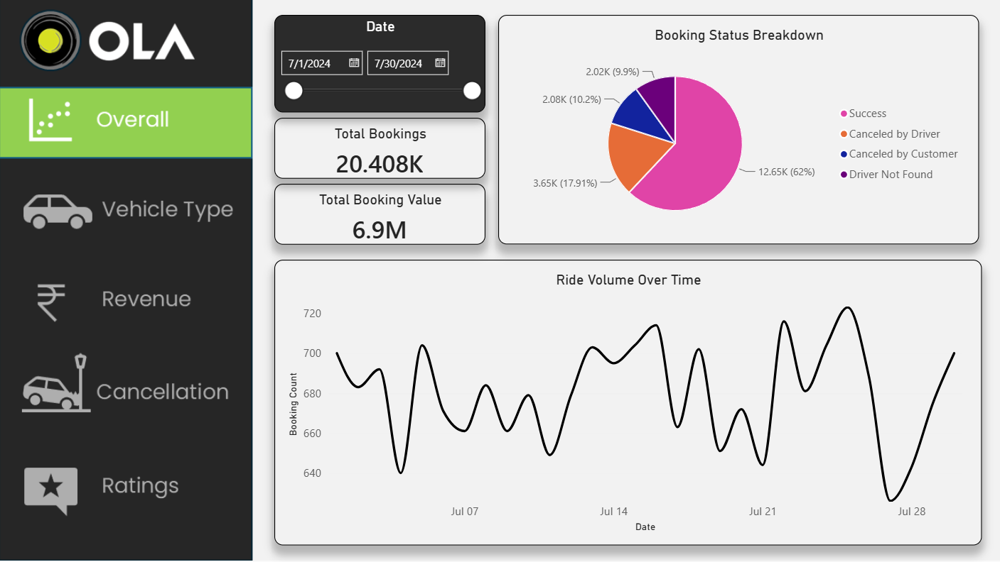
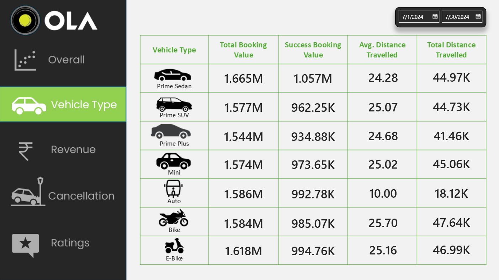
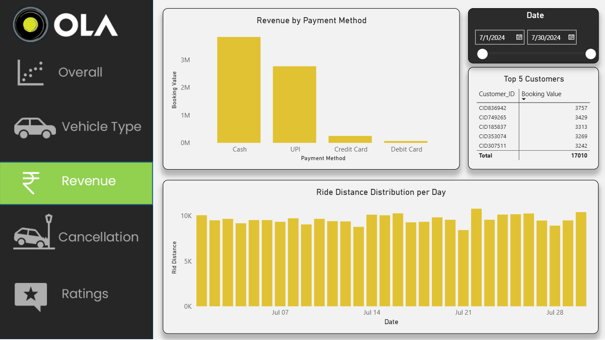
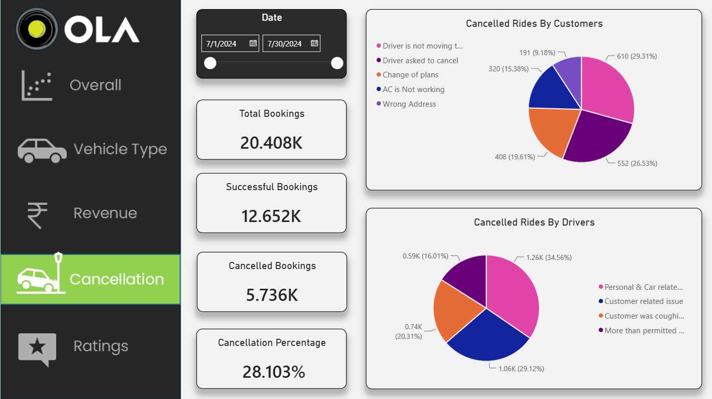
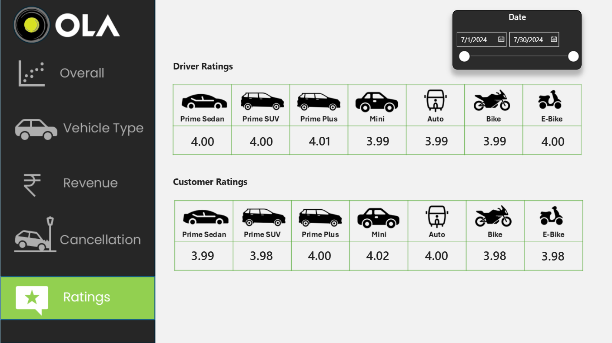

# Ola Ride Booking Analytics

## Project Overview

This project analyzes Ola ride booking data using **MySQL** and **Microsoft Power BI** to understand booking trends, cancellation patterns, revenue, vehicle performance, and customer and driver ratings.

The project includes SQL queries for data analysis and an interactive Power BI dashboard for visualizing key business metrics.

## Tools and Technologies

- **MySQL Workbench** — Data querying and analysis
- **SQL** — Aggregations, filtering, grouping, and views
- **Microsoft Power BI** — Data visualization and dashboard development
- **DAX** — Measures and calculations for reporting

## Project Objectives

- Analyze total and successful bookings.
- Calculate overall booking cancellation rates.
- Examine customer and driver cancellation reasons.
- Compare performance across vehicle types.
- Analyze booking value by payment method.
- Explore ride distance trends over time.
- Compare customer and driver ratings by vehicle type.
- Identify high-value customers.

## Dashboard Overview

### 1. Overall Analysis

Displays total bookings, successful bookings, total booking value, booking status distribution, and ride volume over time.



### 2. Vehicle Type Analysis

Compares booking value, successful booking value, average ride distance, and total distance across vehicle categories.



### 3. Revenue Analysis

Examines revenue by payment method, identifies top customers by booking value, and compares ride distances over time.



### 4. Cancellation Analysis

Analyzes cancelled bookings, overall cancellation percentage, customer cancellation reasons, and driver cancellation reasons.



### 5. Ratings Analysis

Compares driver and customer ratings across different vehicle types.



## SQL Analysis

The SQL scripts include queries and views for:

- Retrieving successful bookings
- Calculating average ride distance by vehicle type
- Counting customer-cancelled rides
- Identifying the top five customers by ride count
- Analyzing driver cancellation reasons
- Finding maximum and minimum driver ratings for Prime Sedan bookings
- Retrieving UPI payments
- Calculating average customer ratings by vehicle type
- Calculating total booking value from successful rides
- Identifying incomplete rides and their reasons

See [`sql/Practice_queries.sql`](sql/Practice_queries.sql) for the SQL code.

## Repository Structure

```text
ola-ride-booking-analytics/
├── README.md
├── sql/
│   └── Practice_queries.sql
└── dashboard/
    ├── Overall.png
    ├── Vehicle_type.png
    ├── Revenue.png
    ├── Cancellation.png
    └── Ratings.png
```

An editable Power BI `.pbix` file can also be included in the `dashboard/` folder if available.

## How to Use This Project

1. Clone or download this repository.
2. Open MySQL Workbench and connect to a MySQL server.
3. Import the source dataset into a table with the expected schema.
4. Update the database name in the SQL script to match your environment.
5. Execute the SQL queries and views.
6. Open the Power BI `.pbix` file if included.
7. Configure the data source connection and refresh the report.

**Note:** The source dataset is not included in this repository. You must have authorized access to the dataset to reproduce the analysis. The database schema and column names must match those expected by the SQL script and Power BI report.

## Key Skills Demonstrated

- SQL querying and data aggregation
- Data analysis and business reporting
- DAX measures and calculations
- Data visualization using Power BI
- KPI development
- Business insights and dashboard design

## Author

Add your name and relevant portfolio links here.
